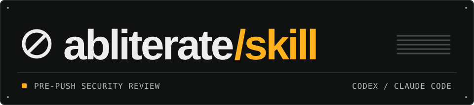
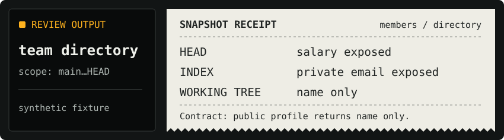

<picture>
  <source media="(max-width: 600px)" srcset="docs/assets/cover-compact.svg">
  
</picture>

# Catch the bug before the push.

Abliterate helps your coding agent answer one question: **what security rule does this change break?** It follows the code to the actual permission check, separates proof from suspicion, and proposes a test that would catch the regression.

[Read the skill](skills/abliterate-review/SKILL.md) · [Browse the eight prompts](#choose-a-prompt) · [Download v0.1.0](https://github.com/andreaborio/abliterate/releases/tag/v0.1.0)

## Install

From your project, using the [Agent Skills CLI](https://github.com/vercel-labs/skills):

```sh
npx skills add andreaborio/abliterate \
  --skill abliterate-review
```

Select your agent and project scope. For an installation without a package manager, download the [versioned skill file](https://github.com/andreaborio/abliterate/blob/v0.1.0/skills/abliterate-review/SKILL.md) and save it as `.agents/skills/abliterate-review/SKILL.md` for Codex or `.claude/skills/abliterate-review/SKILL.md` for Claude Code. Open a new session in that project.

## Try a review

> Use abliterate-review before I push to main. Tell me what is in the commits, which local fixes are still uncommitted, and what test would catch each confirmed regression. Leave my files unchanged.

For a fix: **“Fix the confirmed directory disclosure. Test the private field is absent and the display name is still visible.”** For a feature that does not exist yet: **“Design the access rules for a shared invoice. Which roles and tests do we need before writing the endpoint?”**

## A review you can reproduce

<picture>
  <source media="(max-width: 600px)" srcset="docs/assets/receipt-compact.svg">
  
</picture>

A public profile promises to return only a display name. On disk, it does. But pushing the current commit still sends a serializer that includes salary; committing the current index trades that leak for a private email. Checking only the file open in your editor misses both.

The proposed test asserts the **whole returned object**, not just that the name exists. The fixture proves a serializer regression; it has no HTTP endpoint to establish an exposure in production. [Run the snapshot case yourself →](verification/README.md)

## Choose a prompt

| Topic | Question the review answers |
| --- | --- |
| `design` | What rule should hold, where is it enforced, and how would we test it? |
| `review` | What regression is in the actual push, the index or the working tree? |
| `access` | Which actors may act on this specific resource, including legitimate collaborators? |
| `inputs` | Did an existing or new value reach a different execution or rendering context? |
| `privacy` | Does a private field cross into a response, cache, error message or log? |
| `state` | Does the invariant survive retries, revocation or work handed to a job? |
| `delivery` | Does a dependency or CI change execute with more trust than intended? |
| `fix` | Does a focused test fail before the fix and pass afterward, without breaking allowed use? |

## Terminal packages

Both distributions install the same `abliterate` command. Choose one.

```sh
npm install --global abliterate@0.1.0
# For Python, run in your virtual environment
python -m pip install abliterate==0.1.0
```

```sh
abliterate prompt
abliterate review --since main
abliterate prompt access
```

Package pages and release checksums are available on [npm](https://www.npmjs.com/package/abliterate), [PyPI](https://pypi.org/project/abliterate/0.1.0/) and [GitHub Releases](https://github.com/andreaborio/abliterate/releases/tag/v0.1.0).

Paste the brief into your agent. The CLI itself **prints instructions**: it does not scan the repo, change files, contact a model or gate CI. The agent needs access to the sources; its own data and execution policies apply. The supplied prompts are in Italian and the agent replies in your language.

## Development

The source of truth is [SKILL.md](skills/abliterate-review/SKILL.md). Small Node and Python entry points in [packages](packages) expose that same text without runtime dependencies. To build and check in a fresh clone, use Python 3.11+, Node 18+, npm, Git and uv 0.11.16:

```sh
python3 build.py
python3 verification/check_release.py
```

The checks install both **built packages** in temporary directories and compare their output. [Behavioral cases](verification/README.md) test the reviewer’s decisions separately. See [contributing](CONTRIBUTING.md) or the [security policy](SECURITY.md).
