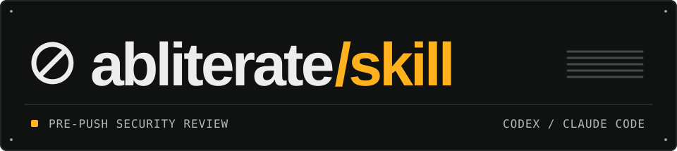

<p align="center">
  
</p>

<h1 align="center">Catch the vulnerability before the push.</h1>

<p align="center">
  Evidence for your coding agent's security review: what changed, where attackers get in,<br>
  which dependencies are really reachable, and which past fixes were incomplete.
</p>

<p align="center">
  <a href="https://www.npmjs.com/package/abliterate"></a>
  <a href="https://pypi.org/project/abliterate/"></a>
  <a href="https://github.com/andreaborio/abliterate/blob/main/LICENSE"></a>
  <a href="https://github.com/andreaborio/abliterate"></a>
</p>

---

abliterate helps your coding agent answer one question: **what security rule does this change break?**

It has three parts. This package is the second one.

| Part | What it does |
| --- | --- |
| **Skill** (Claude Code, Codex, any agent with Agent Skills) | Traces attacker-controlled data from the entry point to the sink, finds the guard on that exact path and tries to disprove every suspicion before reporting it. |
| **Engine** (this package) | A read-only CLI that collects evidence the agent can trust. No install, no dependencies, no model. |
| **Git integration** | A pre-push hook and a GitHub Action that report every pull request to code scanning and in one PR comment. |

There is no abliterate model or service. The reasoning runs in your agent, with its permissions. The engine runs locally.

## Try it

```sh
npx -y abliterate@latest review --since main
```

This prints a review brief for your coding agent with the base filled in. Paste it into Claude Code or Codex, or install the plugin so the agent runs the engine itself.

## Commands

```sh
npx -y abliterate@latest <command>
```

| Command | Output |
| --- | --- |
| `scope --base main` | Verified review states: commits since the merge-base, staged, unstaged, untracked |
| `surface --changed` | Routes, server actions, jobs, webhooks and CI triggers in changed files, with the auth names on each |
| `sinks --changed` | Candidate vulnerable lines by CWE, marked with the snapshot that introduced them |
| `deps --changed` | Dependencies the change added or bumped, with OSV advisories, the CISA KEV flag, EPSS, and whether the vulnerable function is actually called |
| `variants --history` | Patterns that past security fixes in the repo removed, still present elsewhere |
| `variants --from CVE-…` | The same, seeded from an advisory, a fixing commit or a GitHub commit URL |
| `report --in findings.json` | Validates the agent's findings and writes SARIF 2.1.0 and markdown |
| `hook install` | A pre-push hook with the fast checks; non-blocking unless `ABLITERATE_BLOCK=1` |
| `skill`, `prompt`, `review` | Print the bundled skill or a focused prompt for your agent |

Candidates are leads, not findings. The rules recognise common guards (parameterised queries, allowlists, `safe_join`, sanitisers) and stay quiet when one sits on the same path. Secrets are never printed.

## Install the skill and the plugin

**Claude Code** (plugin: both skills and a read-only reviewer agent)

```text
/plugin marketplace add andreaborio/abliterate
/plugin install abliterate@abliterate
```

**Codex**

```sh
codex plugin marketplace add andreaborio/abliterate
```

**Any agent with Agent Skills**

```sh
npx skills add andreaborio/abliterate --skill abliterate-review --skill abliterate-variants
```

Then ask: *"Review what this branch would push against main for security problems."* Each confirmed finding comes with the `file:line`, the actor, the broken rule, the effect, a fix and the test that fails before the fix. Suspicions it could not settle are listed separately, with the one fact that would decide them.

## Pull requests

```yaml
- uses: actions/checkout@v4
  with:
    fetch-depth: 0
- uses: andreaborio/abliterate@v{{VERSION}}
  with:
    agent: claude                       # none | claude | codex
    anthropic-api-key: ${{ secrets.ANTHROPIC_API_KEY }}
    fail-on: high
```

Engine evidence is collected on every PR with no key. With an `agent`, Claude Code or Codex reviews the PR read-only and writes findings that the engine validates. Results go to code scanning as SARIF and to one PR comment that is updated in place. The check fails only on **confirmed** findings that the PR introduced.

## What leaves your machine

- **`deps`** sends package names and versions to `api.osv.dev`, and CVE ids to `api.first.org` (EPSS). It downloads the CISA KEV feed.
- **`variants --from`** fetches a public advisory or GitHub patch.
- **Nothing else** contacts the network. Source code, file paths and repository names are never sent.
- **Offline use:** `--offline` uses only the local cache (`~/.cache/abliterate`), and `deps --inventory` lists packages with no network at all.

## Links

[Documentation and source](https://github.com/andreaborio/abliterate) · [Security policy](https://github.com/andreaborio/abliterate/blob/main/SECURITY.md) · [Issues](https://github.com/andreaborio/abliterate/issues) · [abliterate.io](https://abliterate.io)

MIT license.
