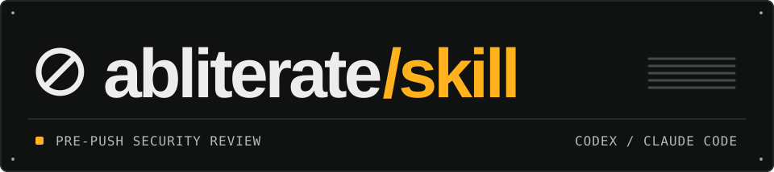

<p align="center">
  
</p>

<h1 align="center">Catch the vulnerability before the push.</h1>

<p align="center">
  The abliterate security review skills and prompts for your coding agent.
</p>

<p align="center">
  <a href="https://pypi.org/project/abliterate/"></a>
  <a href="https://www.npmjs.com/package/abliterate"></a>
  <a href="https://github.com/andreaborio/abliterate/blob/main/LICENSE"></a>
  <a href="https://github.com/andreaborio/abliterate"></a>
</p>

---

abliterate helps your coding agent answer one question: **what security rule does this change break?**

This package ships the review skills and the prompts. It prints them; it does not scan anything, and it never touches the network or your repository.

```sh
pip install abliterate
```

## Use it

```sh
abliterate review --since main     # the pre-push review prompt, with the base filled in
abliterate prompt                  # list the focused prompts
abliterate prompt variants         # print one to paste into your agent
abliterate skill                   # print the abliterate-review skill
abliterate skill abliterate-variants
```

`review` prints a brief that asks your agent to trace the diff in the checkout, report confirmed regressions and propose tests with synthetic data. Paste it into Claude Code, Codex or any agent.

The skill traces attacker-controlled data from the entry point to the sink, finds the guard on that exact path and tries to disprove every suspicion before reporting it. Each confirmed finding comes with the `file:line`, the actor, the broken rule, the effect, a fix and the test that fails before the fix. Suspicions it could not settle are listed separately, with the one fact that would decide them.

## The engine is on npm

Evidence the agent can trust comes from the read-only engine CLI, which is published on npm and needs no install:

```sh
npx -y abliterate@latest sinks --changed --base main      # candidate vulnerable lines the change introduced
npx -y abliterate@latest deps --changed --base main       # new dependencies: OSV, CISA KEV, EPSS, reachability
npx -y abliterate@latest variants --history --base main   # patterns earlier security fixes removed, still present
npx -y abliterate@latest report --in findings.json --sarif out.sarif
```

The commands produce leads, not findings; your agent confirms or disproves each one with the skill. The `skill`, `prompt` and `review` output of this package is byte-identical to the npm package's.

## Plugin, Action and pre-push hook

**Claude Code**

```text
/plugin marketplace add andreaborio/abliterate
/plugin install abliterate@abliterate
```

**Codex**

```sh
codex plugin marketplace add andreaborio/abliterate
```

**Pull requests:** `uses: andreaborio/abliterate@v{{VERSION}}` runs the engine on every PR, optionally with a Claude Code or Codex review, and reports to code scanning and one PR comment.

There is no abliterate model or service: the reasoning runs in your agent, with its permissions.

## Links

[Documentation and source](https://github.com/andreaborio/abliterate) · [Security policy](https://github.com/andreaborio/abliterate/blob/main/SECURITY.md) · [Issues](https://github.com/andreaborio/abliterate/issues) · [abliterate.io](https://abliterate.io)

MIT license.
